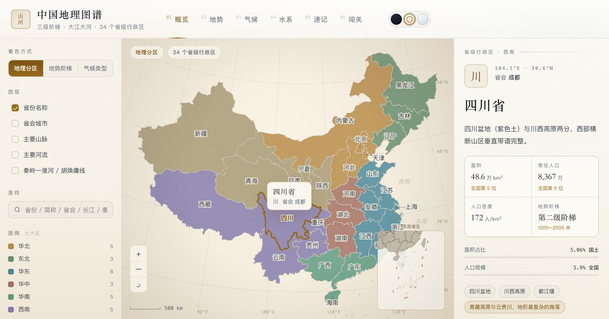

# 中国地理图谱 · 山河

[](https://github.com/szluyu99/china-geo/actions/workflows/ci.yml)
[](https://szluyu99.github.io/china-geo/)

一个可以点、可以问、可以闯关的中国地理交互网页，用来在十几分钟里建立对「三级阶梯、大江大河、气候分区、34 个省级行政区」的直觉。



**纯静态、零后端**：只有 HTML/CSS/JS 三个文件（打包后是一个 HTML），没有接口、没有数据库、没有构建服务器，双击就能用，也可以直接丢到任何静态托管上。

## 打开方式

- **单文件版**：双击 `dist/china-geo.html`（约 550 KB，样式与数据全部内联，可以发微信 / 邮件给别人，离线可用）。
- **开发版**：双击 `index.html`，或在本目录起一个静态服务：

```bash
python3 -m http.server 8765
# 打开 http://127.0.0.1:8765/index.html
```

## 主题

右上角三个色块切换主题，选择会记在 `localStorage` 里，下次打开还是它：

| 主题 | 说明 |
| --- | --- |
| 夜 | 原来的深色图册风，暗环境下最舒服 |
| 纸 | 暖纸浅色，像印刷地图集 |
| 日 | 冷白浅色，白天 / 投影时对比最清楚 |

第一次打开会跟随系统的浅色 / 深色偏好；之后以你手动选的为准。界面的颜色与地图画布的颜色是两套机制（CSS 变量 + Canvas 调色板），切主题时地图会整体重绘。

## 六种视图

| 视图 | 内容 |
| --- | --- |
| 概览 | 七大地理分区着色，点省份看地形 / 气候 / 面积 / 人口 / 排名 |
| 地势 | 三级阶梯着色 + 沿北纬 30° 的地形剖面图 + 39 个地形区标签 |
| 气候 | 五种气候类型着色，秦岭—淮河与干湿地带说明 |
| 水系 | 六条主要河流的走向与流域，点河流看源头、入海口、沿途省区 |
| 速记 | 10 张知识卡：三级阶梯、四大高原、三大盆地、三大平原、分界线、气候、中国之最、邻国、海域、省级速记 |
| 闯关 | 四种模式（混合 / 地图找省份 / 省会配对 / 地理常识），10 题一轮；答完立刻给出解析，错题回顾也带解析 |

地图交互：滚轮以光标为中心缩放，拖拽平移，`+` / `-` 缩放，`Esc` 取消选中；左栏切换着色方式、图层（省份名称 / 省会城市 / 山脉 / 河流 / 分界线）；右上角全站搜索（省份、简称、省会、河流、山脉）。右下角是南海诸岛附图。

**分享指到具体位置**：地址栏会跟着当前状态变，比如
`https://szluyu99.github.io/china-geo/?theme=paper&tab=climate&p=四川省`，
或者 `?tab=water&river=长江`、`?tab=landform&mountain=秦岭`。参数支持 `theme`（night / paper / day）、`tab`（explore / landform / climate / water / quiz）、`p`、`river`、`mountain`，发给别人打开就是同一视图同一省份。

**图层勾选会被记住**：勾过之后切视图、用搜索跳转、甚至刷新页面都不会被重置回默认（只有闯关视图会临时隐藏省名，出来自动恢复）。

## 关于页

右上角「关于」里写了数据来源与口径（DataV 边界、七普人口、河流长度的取值），以及「本图是教学示意、不能作为边界主张依据」的说明。`Esc` 或点遮罩关闭。

## 开发与自检

```bash
npm run check    # 数据体检：34 省 / 面积与人口合计 / 题目答案 / 图形完整性
npm run build    # check + 打包单文件
npm run smoke    # 用本机 Chrome 跑冒烟测试（画布、标签不重叠、六视图、点击、搜索、主题、深链接）
npm run verify   # check + smoke
```

两个脚本都零依赖：`check-data.js` 直接在 Node 里跑数据断言；`smoke.js` 用系统 Chrome 的 DevTools 协议驱动页面，找不到浏览器时可用 `CHROME=/path/to/chrome` 指定。CI 跑同一套（`.github/workflows/ci.yml`），PR 里会拦住改坏数据或改坏渲染的提交。

## 目录

```
china-geo/
├── index.html              页面骨架（开发版）
├── assets/
│   ├── styles.css          三套主题的样式（CSS 变量）
│   ├── geo.js              地图数据 window.CN_GEO（34 省 + 九段线）
│   ├── content.js          文字与知识数据 window.CN_CONTENT
│   └── app.js              Albers 投影、Canvas 绘制、主题调色板、交互与测验
├── scripts/
│   ├── build-geo.js        把 DataV GeoJSON 转成 assets/geo.js
│   └── build-single.js     把 index.html + assets 打包成 dist/china-geo.html
└── dist/china-geo.html     单文件成品
```

重新生成：

```bash
node scripts/build-geo.js    # 需要 /tmp/cn_datav.json（DataV 100000_full）
node scripts/build-single.js # 生成 dist/china-geo.html
```

## 部署到 GitHub Pages

仓库里已经带好 `.github/workflows/pages.yml`：推到 `main` 就会自动打包并发布。

```bash
git init
git add .
git commit -m "feat: 中国地理图谱"
git branch -M main
git remote add origin git@github.com:<你的用户名>/china-geo.git
git push -u origin main
```

然后到仓库 **Settings → Pages**，把 Source 选成 **GitHub Actions**（只需设置一次）。之后每次 push 都会自动构建，发布地址是 `https://<你的用户名>.github.io/china-geo/`，单文件版在 `/china-geo.html`。

工作流做了两件事：`node scripts/build-single.js` 打包，并把打包产物当作首页（`_site/index.html`），所以线上打开就是单文件版，不需要额外请求 assets。构建最后会检查产物里没有残留 `assets/` 引用，防止内联失败被静默发布。

## 无障碍与移动端

- 键盘：地图可 Tab 聚焦，方向键平移、`+` / `-` 缩放、`0` 复位、`Esc` 取消选中；在搜索框里打字不会误触发地图快捷键。
- 读屏：地图带 `role="application"` 与中文操作说明（`#mapHelp`），tab 按钮、主题按钮、缩放按钮都有 `aria-label` / `aria-pressed`。
- 触屏：双指捏合缩放、单指拖动平移；触屏设备上主题与缩放按钮放大到 34–44px。
- 动效：尊重系统「减少动态效果」，开启后入场扫光与镜头飞行都变成瞬间到位。

## 实现要点

- **投影**：手写 Albers 等积圆锥投影（标准纬线 25°N / 47°N，中央经线 105°E），一次性把经纬度转成世界坐标并预生成 `Path2D`，之后缩放平移只改变换矩阵。
- **命中**：另建一张离屏 `pickCanvas`，把每个省画成一种颜色，点击时 `getImageData` 读回索引；山脉、河流则按到折线的距离判定。小省（京津沪港澳）额外有 12px 吸附半径。
- **标签**：逐省尝试放置，用矩形碰撞剔除，先放大分界线 / 阶梯名占位，再放省名，保证 1440 / 1280 / 1100 / 1024 宽度下都无重叠。
- **取景**：海南省在数据里含三沙群岛（最南到 3.8°N），主图只用海南岛范围参与取景，否则大陆会被压得很小；完整的南海用右下角附图呈现。
- **性能**：静态层（海面、省填充、边界、标签、附图）画到一张离屏画布并缓存，缓存键由视图/主题/图层/选中项组成；鼠标在省份间移动只贴图 + 叠一层金色高亮，不再重画整张地图（实测 40 次跨省 hover 从 27 次长任务降到 0 次）。
- **主题**：界面颜色走 CSS 变量（`--ink-rgb` 之类的通道三元组，深色用 `rgb(var(--x) / α)` 叠加），地图画布的颜色单独由 `NIGHT / PAPER / DAY` 三套调色板提供，`draw*` 只读 `TH.*`；浅色下省色会做一次压深（`mixHex`）并提高填充不透明度，避免整片发灰。

## 数据口径

- 地图边界：阿里云 DataV `100000_full.json`（仅用于教学示意）。
- 面积：约数（万 km²）；人口：第七次全国人口普查（2020 年，万人）。
- 河流长度取常见公开值（长江约 6300 km、黄河约 5464 km 等），不同资料口径略有差异。

`window.__DBG` 是留给自动化测试的调试出口（标签矩形、命中结果、投影参数），不影响正常使用。
